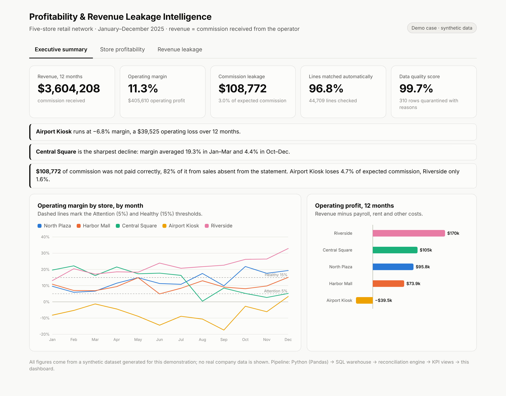
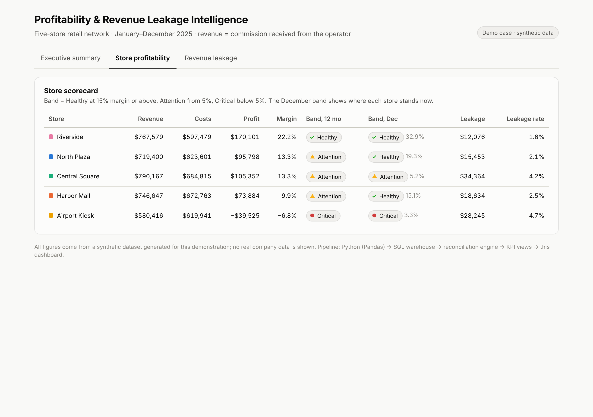
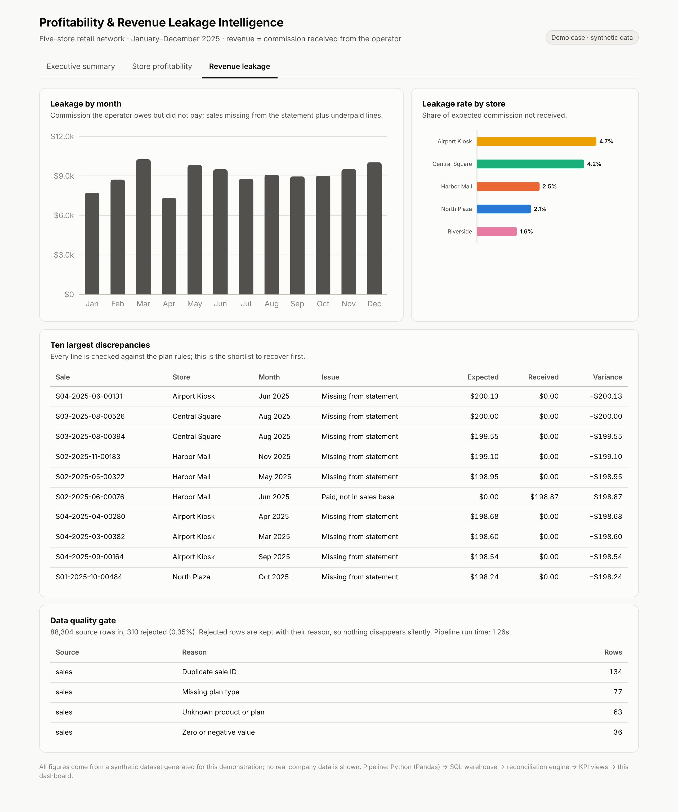

# Retail Profitability & Revenue Leakage Analytics

End-to-end analytics case for a retail network that sells telecom products (mobile, broadband, TV, devices) and is paid a commission per sale by the operator. It answers two questions owners rarely can: **which stores actually make money**, and **how much commission was never paid**.

**[Open the live dashboard](https://luan-dantas-analytics.github.io/retail-profitability-leakage-analytics/dashboard/)** (interactive, filters and tooltips on every chart)

> **All data is synthetic**, generated by `etl/generate_data.py` (seed 42). No real company data is used. Figures below describe the simulated network, not a delivered client result.



## The business problem
1. Owners see sales but not **store-level profit**, so margin problems surface months late.
2. The operator's commission statement is rarely checked line by line, so **underpaid or missing commission goes unnoticed**.
3. Data arrives from several sources in inconsistent formats.

## What it does
| Layer | Tech | Output |
|---|---|---|
| Ingest + clean | Python, Pandas | Standardized sales; rejected rows quarantined with a reason |
| Warehouse | SQL (SQLite demo, PostgreSQL-ready) | Star schema + KPI views in `sql/` |
| Reconciliation | Python, NumPy | Expected vs received commission per sale, 5 statuses |
| KPI API | Java, Spring Boot | Read-only REST endpoints over the views (`api/`), skeleton, not yet compiled or tested |
| BI | Power BI DAX | Measures in `powerbi/measures.dax`; `.pbix` not included |
| Dashboard | HTML / SVG | `dashboard/index.html`, screenshots in `docs/` |

## Results on the simulated data
- 88,304 source rows, **99.65% passed validation**; 310 rejected rows kept in a quarantine table with the reason.
- **96.8% of commission lines reconcile automatically.** Leakage is **$108.8k (3.0% of expected commission)**, mostly sales missing from the operator statement.
- One store runs at a loss (-6.8% margin) and another falls from about 19% to 4% in the last quarter, the kind of finding the dashboard is built to surface.
- Margin bands (Healthy >= 15%, Attention 5-15%, Critical < 5%) are illustrative thresholds to agree with a real client.




## Reconciliation statuses
`ok` · `underpaid` · `overpaid` · `missing_in_statement` · `not_in_sales_base`

## Run it
```bash
pip install -r requirements.txt
python etl/generate_data.py      # synthetic raw files
python -m etl.pipeline           # clean, load, reconcile, export
python dashboard/build_dashboard.py
python -m pytest -q              # reconciliation tests
```

## Design choices
- Facts are aggregated to store x month **before** joining, which avoids inflated totals.
- KPI logic lives once, in SQL views; the dashboard, API and Power BI read the same definitions.
- Reconciliation is covered by unit tests.

## Repository layout
```
etl/            data generation, cleaning, load, quarantine
sql/            star schema and KPI views
reconciliation/ expected vs received commission engine
dashboard/      interactive HTML dashboard
powerbi/        DAX measures
api/            Spring Boot REST skeleton
tests/          reconciliation unit tests
exports/        CSV outputs of the pipeline
docs/           dashboard screenshots
```

## Need something like this?
I build BI dashboards, ETL pipelines and reconciliation tools for retail and telecom operations. Reach out through my Upwork or Fiverr profile.
